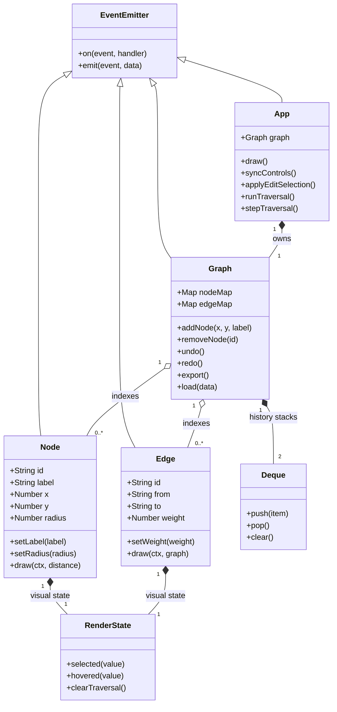
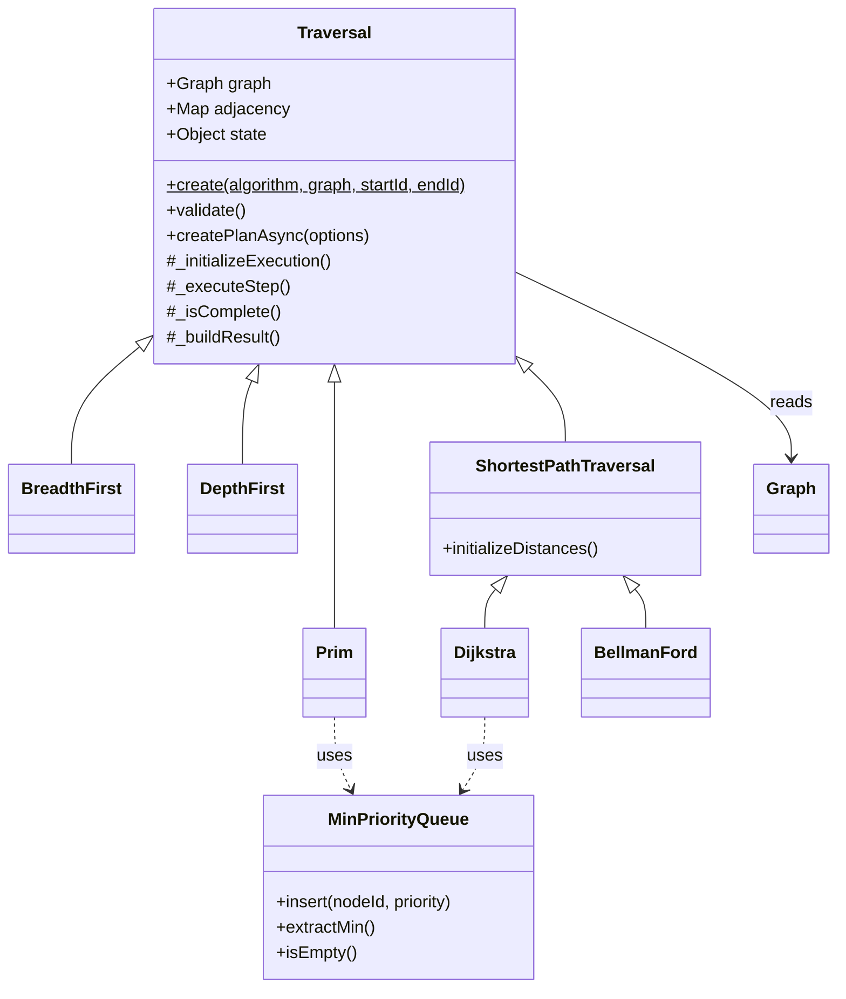
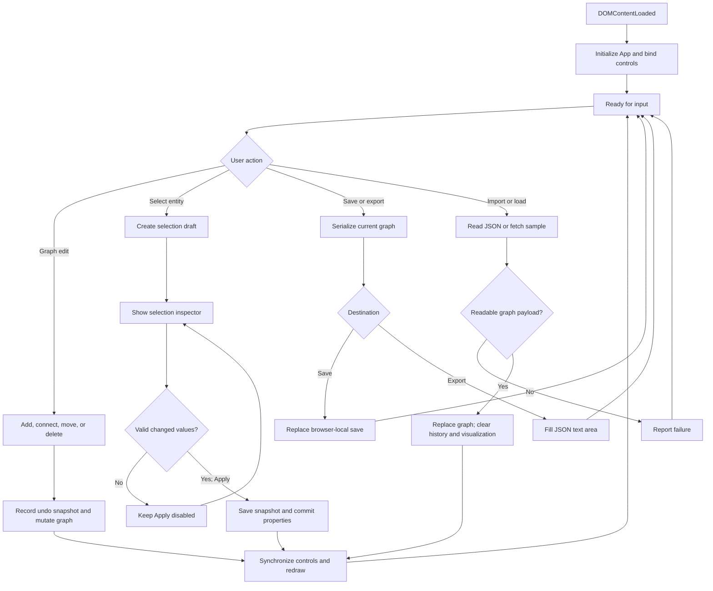
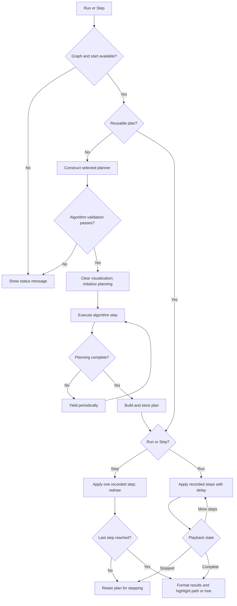

# Graph Visualizer — Software Documentation

**Document ID:** GV-SD

**Revision:** 1.0

**Author:** Daniel Tongu

**Audience:** users, developers, and reviewers

**Repository:** [graph-visualizer](https://github.com/danielTongu/graph-visualizer)

## Abstract

Graph Visualizer is a browser application for constructing graphs and observing
breadth-first search, depth-first search, Dijkstra, Bellman-Ford, and Prim algorithms.
It combines an HTML5 Canvas editor with step-based animation, editable graph
properties, bounded undo/redo, JSON exchange, and browser-local storage. The
implementation uses HTML, CSS, and JavaScript without a framework or build step.

This README is a project-tailored IEEE-style software document: numbered sections,
identified requirements, design descriptions, operating procedures, and verification
traceability. It does not claim conformance to a specific IEEE standard. Requirements
describe intended current behavior; verification status is stated separately.

## Contents

1. [Introduction](#1-introduction)
2. [System overview](#2-system-overview)
3. [Software requirements](#3-software-requirements)
4. [Software design](#4-software-design)
   - [Graph/controller UML](#45-uml-class-diagram--graph-and-controller)
   - [Algorithm UML](#46-uml-class-diagram--algorithm-hierarchy)
   - [Editing and persistence flow](#47-application-flow--editing-and-persistence)
   - [Traversal flow](#48-application-flow--traversal-planning-and-playback)
5. [Data design and interfaces](#5-data-design-and-interfaces)
6. [Operating procedures](#6-operating-procedures)
7. [Verification and validation](#7-verification-and-validation)
8. [Maintenance and limitations](#8-maintenance-and-limitations)
9. [Project references](#9-project-references)

## 1. Introduction

### 1.1. Purpose and scope

The program supports interactive graph-algorithm learning and demonstrations in a
single browser tab. Users create and edit nodes and edges, select an algorithm,
and inspect its animated execution and results. There is no application server,
user account, authentication system, or shared database.

### 1.2. Terms and notation

| Term | Definition |
| --- | --- |
| Node / vertex | An identified graph element with a label, position, and radius |
| Edge | A connection between two distinct nodes, optionally directed and weighted |
| Traversal plan | Recorded algorithm steps and results consumed by the playback controller |
| Selection draft | Pending property edits; committed through Apply changes |
| MST | Minimum spanning tree; Prim returns a partial tree when the graph is disconnected |
| V / E | Number of vertices / edges |
| FR / NFR / TC | Functional requirement / nonfunctional requirement / verification case |

## 2. System overview

### 2.1. Execution environment

Use a modern browser supporting Canvas 2D, JavaScript classes with private fields,
Pointer Events, ResizeObserver, Fetch, and Web Storage. Serve the repository through
HTTP so that the bundled sample can be fetched reliably. Browser support and capacity
have not been certified against a browser-version matrix.

Python 3 is one optional local-server tool. Node.js is optional for JavaScript syntax
checking. Neither is an application runtime dependency for end users.

### 2.2. Source organization

| File | Responsibility |
| --- | --- |
| [index.html](index.html) | Canvas, toolbar, sidebar forms, help, results, and status areas |
| [index.css](index.css) | Dark slate/teal theme, purple selection styling, responsive layout |
| [index.js](index.js) | Models, data structures, algorithms, rendering, event handling, persistence |
| [sample-graph-data.json](sample-graph-data.json) | Bundled example loaded through Fetch |
| [README.md](README.md) | Program specification, design, operation, and verification guidance |

### 2.3. User interface

The main panel contains editing tools, history and view controls, a graph canvas,
results, and status feedback. The sidebar contains Graph settings, Algorithm, and
Import / Export panels. On desktop, the sidebar stretches to the main panel's height
and scrolls internally. At narrower widths, the panels move below the canvas.

The selection inspector uses the graph's purple selection accent. It identifies
the selected node or edge, explains editable fields, reports draft validity, and
separates Apply changes from deletion.

## 3. Software requirements

### 3.1. Functional requirements

| ID | Capability | Required behavior |
| --- | --- | --- |
| FR-01 | Construct graphs | The program shall add nodes and connect existing distinct nodes, rejecting self-loops and duplicate connections. |
| FR-02 | Configure graphs | The program shall support directed/undirected and weighted/unweighted modes. |
| FR-03 | Edit selection | The program shall edit node labels/radii and weighted edge costs through a selection draft, enabling Apply only for valid changed values. |
| FR-04 | Move and delete | The program shall move nodes by dragging and delete selected nodes with their incident edges, or individual edges. |
| FR-05 | Navigate the canvas | The program shall pan, zoom, reset the view, and fit node bounds into the viewport. |
| FR-06 | Restore edits | The program shall provide bounded snapshot undo/redo and disable unavailable history buttons. |
| FR-07 | Execute algorithms | The program shall provide BFS, DFS, Dijkstra, Bellman-Ford, and Prim with the constraints in Section 4.3. |
| FR-08 | Control playback | The program shall support automatic playback, manual steps, stop, and visualization reset. |
| FR-09 | Present results | The program shall display traversal output and applicable distance/path, negative-cycle, or tree results. |
| FR-10 | Exchange graphs | The program shall export JSON to a text area and import graph JSON from it. |
| FR-11 | Retain a local save | The program shall save one graph with a timestamp in browser storage and load it on request. |
| FR-12 | Provide examples | The program shall fetch the bundled sample and report load failures. |

### 3.2. Quality requirements

| ID | Attribute | Required behavior |
| --- | --- | --- |
| NFR-01 | Maintainability | Classes and functions shall document their responsibilities; shared model and traversal behavior shall be centralized. |
| NFR-02 | Reproducibility | Traversals shall use ordered adjacency lists; rendering shall retain explicit node/edge order. |
| NFR-03 | Rendering quality | Canvas buffers shall account for device pixel ratio and resize with the displayed canvas. |
| NFR-04 | Responsiveness | Asynchronous planning shall periodically yield; playback shall support interruption. This is not a measured latency guarantee. |
| NFR-05 | Usability | Controls shall have meaningful labels, focus indicators, contextual guidance, and responsive layouts. Full keyboard editing and accessibility conformance are not established. |

### 3.3. Constraints and rules

1. Node labels must be nonempty after trimming. Duplicate display labels are not prohibited; IDs distinguish nodes.
2. Node radius is 5–200 world-space pixels. A null override uses the current global default, initially 17.
3. Edge costs entered through the inspector must be finite and between −1,000,000 and 1,000,000.
4. Unweighted traversal costs are 1. BFS and DFS use graph connectivity rather than accumulated edge costs.
5. Undo and redo stacks default to 25 snapshots each. `Graph` accepts a source-level `historyLimit` option bounded to 1–1000; no settings control exposes it.
6. New history entries clear redo. UI imports, sample/local loads, and Clear reset history; they cannot be recovered through Undo.
7. Save overwrites the single browser-local save. Data belongs to the current origin/browser profile; it is not synchronized or backed up remotely.

## 4. Software design

### 4.1. Components and ownership

| Component | Classes | Responsibility |
| --- | --- | --- |
| Utilities | `EventEmitter`, `TypeAssert`, `Geometry` | Events, runtime checks, geometry and hit testing |
| Visual model | `RenderState`, `Node`, `Edge` | Entity properties, visual flags, entity drawing |
| Graph model | `Graph`, `Deque` | Maps/indexes, insertion order, graph mutations, snapshot history |
| Algorithm infrastructure | `Traversal`, `ShortestPathTraversal`, `MinPriorityQueue` | Ordered adjacency, execution lifecycle, distance initialization, heap operations |
| Algorithm planners | `BreadthFirst`, `DepthFirst`, `Dijkstra`, `BellmanFord`, `Prim` | Algorithm-specific steps and results |
| Result presentation | `TraversalResult` | Result formatting and final path/tree highlighting |
| Application control | `App`, `ModeOptions` | DOM binding, selection drafts, pointer/keyboard input, viewport, playback and storage |
| Diagnostics | `PerformanceMonitor`, `ErrorBoundary` | Optional timing support and global error reporting |

These are logical responsibilities within one JavaScript file, not separately
packaged modules. Nodes and edges combine model properties with drawing behavior;
`App` coordinates several UI and persistence responsibilities.

### 4.2. Startup and operation

On `DOMContentLoaded`, initialization registers error handling and starts `App`.
The controller collects DOM references, acquires a Canvas 2D context, creates UI state,
binds events, observes canvas resizing, and synchronizes controls.

An algorithm request reads its settings, constructs a planner through
`Traversal.create`, validates the request, and asynchronously builds a plan.
The shared execution lifecycle initializes algorithm state, executes steps until
complete, periodically yields, and builds the result. Playback applies recorded
visual steps and redraws. A run token invalidates obsolete animation loops when
playback is stopped or reset; planning itself is not protected by the same mechanism.

### 4.3. Algorithm design

| Algorithm | Mechanism | Constraints and result |
| --- | --- | --- |
| BFS | FIFO frontier | Reachable nodes in breadth-first order; shortest edge-count paths in unweighted graphs |
| DFS | Explicit stack frames | Reachable nodes in depth-first order; does not guarantee shortest paths |
| Dijkstra | Binary min-heap and relaxation | Rejects a graph containing negative edge weights; produces distances and predecessors |
| Bellman-Ford | Repeated relaxation passes | Supports negative weights in directed graphs; detects reachable negative cycles |
| Prim | Heap of candidate connections | Requires an undirected graph; reports total tree weight and whether all nodes were reached |

Typical algorithm-core time bounds are O(V + E) for BFS/DFS,
O((V + E) log V) for heap-based Dijkstra/Prim on simple graphs, and O(VE) for
Bellman-Ford. These exclude this application's adjacency sorting, recorded animation
steps, distance snapshots, and rendering. Full planner memory and runtime therefore
must not be inferred from textbook working-space bounds alone.

Neighbor comparison uses edge weight when weighted, followed by node comparison.
BFS/DFS can consequently visit equal-depth or alternative branches in an order
influenced by weights, without treating those weights as shortest-path costs.

### 4.4. Rendering and visual states

`App.draw()` clears the backing buffer, paints the background and grid, applies
viewport translation/scaling, draws edges in `edgeOrder`, then draws nodes in
`nodeOrder`. Each node draws its own label and applicable distance badge.

State precedence, from lowest to highest, is discovered, exploring, explored,
path, selected, hovered. Selected entities use fill `#4c1d95` and stroke `#c084fc`.
Hover styling overrides selection while the pointer remains over the entity.
Styles are cached until visual flags change.

### 4.5. UML class diagram — graph and controller

Figure 1 shows the main runtime classes and their relationships. `*--` denotes
composition, `o--` aggregation, `-->` a retained reference, `..>` a usage dependency,
and `<|--` inheritance. Members are representative rather than exhaustive.
`Graph` aggregates node/edge instances; deleting a node also removes its incident edges.



**Figure 1.** Controller, graph entities, and history ownership. Edge endpoints are
node IDs, not direct `Node` object references. Supporting utilities and DOM objects
are omitted to keep the view focused.

### 4.6. UML class diagram — algorithm hierarchy



**Figure 2.** Shared planning lifecycle and algorithm specialization. The `#` members
are protected-by-convention hooks with underscore-prefixed JavaScript names, not
JavaScript private fields. `Traversal` supplies shared behavior and throwing hooks;
it is conceptually a base class, not a language-enforced abstract class.

### 4.7. Application flow — editing and persistence



**Figure 3.** Main editing and persistence branches. Import validity is deliberately
not represented as full schema validation: malformed records can be skipped after
replacement begins, as described in Section 5.2. Selection drafts do not change the
model until Apply; loading is a separate replacement path without undo preservation.

### 4.8. Application flow — traversal planning and playback



**Figure 4.** Successful planning and playback, with validation rejection. Exceptions
are caught by the controller and reported through status feedback. Run rejects an
already-running animation. Stop invalidates animation through a token; Reset clears
the plan and visual state. This diagram does not imply that asynchronous planning
has a cancellation lock or is isolated from concurrent graph changes.

## 5. Data design and interfaces

### 5.1. In-memory representation

`Graph` owns node and edge maps, ordered ID arrays, a connection-key map, and an
incident-edge index per node. New node IDs use the available UUID facility with a
fallback generator. Directed edge IDs use `e:from->to`; undirected IDs use
`e:first--second`, with endpoint strings sorted lexicographically.

Selection drafts retain editable values separately from graph entities until Apply.
Traversal state contains recorded steps, discovery order, predecessor relationships,
and algorithm-specific distances or metadata. Steps use `discover`, `explore`, and
`finish` types with `nodeId` and optional edge/source/distance information.

### 5.2. Graph JSON

The following complete example is suitable for the Import / Export text area:

```json
{
  "version": 1,
  "directed": false,
  "weighted": true,
  "nodes": [
    {"id": "a", "label": "A", "x": 120, "y": 160, "radius": null},
    {"id": "b", "label": "B", "x": 340, "y": 160, "radius": 20}
  ],
  "edges": [
    {"id": "e:a--b", "from": "a", "to": "b", "weight": 5}
  ]
}
```

| Field | Meaning |
| --- | --- |
| `version` | Export format marker, currently 1; unsupported versions are not rejected |
| `directed`, `weighted` | Graph mode flags |
| `nodes` | Node records with ID, label, finite coordinates, and nullable radius |
| `edges` | Endpoint references and costs; imported IDs are regenerated from endpoints |

Import is permissive: it converts some values and skips invalid/duplicate nodes or
edges, reporting details to the console. It does not provide atomic validation or
a full UI summary of skipped records. A syntactically valid document may replace
the current graph with an incomplete graph.

### 5.3. Local save interface

The `localStorage` key is `graph-state`. New saves contain an envelope with
`version: 1`, `timestamp` in epoch milliseconds, and `data` containing the graph
export. The loader also accepts older unwrapped graph objects. Exports do not
include viewport, playback state, selection drafts, undo history, or a global
node-radius preference.

## 6. Operating procedures

### 6.1. Launch

From the repository directory, run:

```bash
python3 -m http.server 8000
```

Open [http://localhost:8000](http://localhost:8000). Stop the server with Ctrl+C.
There is no dependency installation or build step. Opening `index.html` directly
may prevent sample loading because of browser restrictions on local-file requests.

### 6.2. Create and edit a graph

1. Select **Add Node**, choose a label style/default radius, and click empty canvas locations.
2. Select **Add Edge**, then click the source and destination nodes. Enable Weighted to assign costs.
3. Click a node or edge to inspect it. Modify its properties and select **Apply changes** when enabled.
4. Use the inspector's × button to deselect. Clicking empty space in Select/Add Edge clears selection without switching to Add Node.
5. Drag a node to reposition it. Delete through the inspector's **Delete** action; deleting a node removes incident edges.
6. Use Undo/Redo for supported edits. Double-click does not delete entities.

### 6.3. Run an algorithm

1. Create a graph or select **Load sample graph**.
2. Choose an algorithm and review its contextual constraints.
3. Choose the start and optional target. Prim disables the target selector.
4. Set the step delay: higher values slow playback; 0 uses full-speed playback.
5. Select **Run algorithm** or **Step**. **Stop** halts playback while retaining the plan for stepping; **Reset** clears visualization.
6. Review Results and the canvas highlighting. Use **Fit graph** if nodes lie outside the view.

### 6.4. Navigation and keyboard controls

| Action | Input |
| --- | --- |
| Pan | Drag background, Alt + drag, or middle-button drag |
| Zoom | Wheel or zoom buttons; pointer-centered for wheel input |
| Fit all nodes | Fit graph button |
| Reset pan/zoom | Percentage button or Ctrl/Cmd + 0 |
| Undo | Toolbar button or Ctrl/Cmd + Z |
| Redo | Toolbar button, Ctrl/Cmd + Shift + Z, or Ctrl/Cmd + Y |
| Zoom in/out | Ctrl/Cmd + = / Ctrl/Cmd + - |
| Delete selection | Delete or Backspace while the canvas has keyboard focus |

Application shortcuts leave input fields, text areas, selects, and editable content
to their native editing behavior. Zoom is bounded to 0.05×–100×.

### 6.5. Save, exchange, and recover

**Save graph** replaces the browser-local save. **Load saved** replaces the canvas
with that save. **Export JSON** writes the current graph into the text area; copy
that text to retain a separate file. **Import JSON** reads the text area and replaces
the current graph. No download or file-picker workflow is implemented.

Export important work before Clear, Import, or either load operation because these
reset history. If a sample fails to load, check the HTTP server and browser console.
If local storage fails, use JSON export; storage may be unavailable or full. For
algorithm errors, check graph direction, negative weights, and selected start node.

## 7. Verification and validation

### 7.1. Evidence and acceptance status

JavaScript syntax, static DOM/reference checks, and focused selection-draft checks
were performed during the UI work. They do not establish complete application
correctness. There is no committed automated regression suite. Browser-based visual,
interaction, cross-browser, and mobile verification remains pending.

Run the available syntax and whitespace checks from the repository directory:

```bash
node --check index.js
git diff --check
```

### 7.2. Requirement traceability and manual acceptance plan

The following cases specify expected checks; they are not recorded browser test passes.

| Case | Requirements | Procedure and expected result |
| --- | --- | --- |
| TC-01 | FR-01, FR-02 | Create two nodes and connect them; reject a self-loop/duplicate; inspect arrow and weight behavior after mode changes. |
| TC-02 | FR-03, NFR-05 | Select a node; enter a blank label or out-of-range radius; Apply remains disabled. Enter valid changed values, apply, and inspect canvas text/size. |
| TC-03 | FR-04, FR-06 | Move a node, undo/redo, delete it, then undo; verify its incident edges and original properties are restored. |
| TC-04 | FR-05, NFR-03 | Pan/zoom, fit a graph containing offscreen nodes, reset to 100%, and resize the window; inspect bounds and sharpness. |
| TC-05 | FR-07, FR-09 | With weighted edges A–B=1, B–C=2, A–C=5, run Dijkstra from A to C; expect distance 3 via B. |
| TC-06 | FR-07, FR-09 | In directed mode use A→B=1, B→C=−2, C→B=1; Bellman-Ford must report a reachable negative cycle. Dijkstra must reject negative weights. |
| TC-07 | FR-07, FR-09 | Run Prim on the TC-05 undirected graph; expect tree weight 3. Add an isolated node and expect a partial-tree result. |
| TC-08 | FR-07, FR-08 | Run BFS/DFS, step manually, stop automatic playback, then reset; verify orders, highlights, and cleared visual state. |
| TC-09 | FR-10, FR-11 | Export and reimport Section 5.2; save/load locally; verify endpoints, labels, positions, radii, costs, and reset history. |
| TC-10 | FR-12 | Load the sample over HTTP; check success feedback. Simulate an unavailable sample and check failure feedback. |
| TC-11 | NFR-02–NFR-05 | Repeat traversals; inspect stable order, keyboard focus, text-field undo, responsive layout, and sidebar height at desktop widths. |

TC-05 through TC-07 use controlled fixtures rather than relying on the bundled
sample's topology. No measured performance threshold or accessibility certification
is implied by these procedures.

## 8. Maintenance and limitations

### 8.1. Change procedure

Keep class/function comments aligned with behavior. Update the relevant FR/NFR rows,
operating instructions, and acceptance cases when changing a user workflow. Preserve
DOM IDs referenced by `App`, or update both HTML and controller references together.
Algorithm additions require factory registration, a selector option, planner hooks,
result formatting where applicable, and corresponding verification cases.

### 8.2. Known boundaries

The application has no server persistence, collaboration, automatic layout,
parallel edges, self-loops, file-picker import, or image export. Keyboard-only graph
construction and touch gesture workflows are incomplete. Large graphs and recorded
plans may consume substantial memory; no supported maximum graph size is measured.

Traversal preparation can overlap with subsequent requests or graph changes.
Selection changes can discard unfinished drafts. Graph replacement is not
transactionally validated. Traversal result formatting interpolates labels into
HTML; untrusted imported labels are not safely escaped. These are implementation
limitations, not completed safeguards or additional feature commitments.

### 8.3. Authorship and licensing

Author: [Daniel Tongu](https://github.com/danielTongu).
No license file is present in this repository; this document does not grant a license.

## 9. Project references

[1] [User interface structure](index.html), application source.

[2] [Visual presentation](index.css), application source.

[3] [Program implementation](index.js), authoritative behavior and data handling.

[4] [Bundled graph fixture](sample-graph-data.json), sample input.
